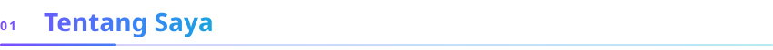
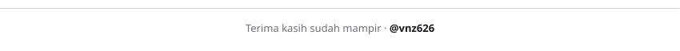

 

Halo! Saya **Kevin Beding**, mahasiswa S1 Teknologi Informasi di Universitas Negeri Yogyakarta (UNY) yang suka memadukan **UI/UX** dan **pengembangan fullstack** untuk membangun produk yang berguna, rapi, dan enak dipakai.
Saya percaya kode yang baik itu seperti tulisan dan desain yang baik: jelas, ringkas, dan mudah dipahami orang lain.

<table>
<tr>
<td width="50%" valign="top">

**Berbasis di** 
Yogyakarta, Indonesia

**Latar belakang** 
S1 Teknologi Informasi — Universitas Negeri Yogyakarta (UNY)

</td>
<td width="50%" valign="top">

**Lagi belajar** 
Fullstack Web Development

**Tanya saya soal** 
UI/UX Design &amp; Web Development

</td>
</tr>
</table>

 

| | |
|---|---|
| **Bahasa** | HTML · CSS · JavaScript · TypeScript · Python · PHP |
| **Frontend** | React · Next.js · Tailwind CSS |
| **Backend** | Node.js · Express · Laravel |
| **Database** | PostgreSQL · MySQL · MongoDB |
| **UI/UX &amp; Tools** | Figma · Git · VS Code · Docker · Postman |

 

